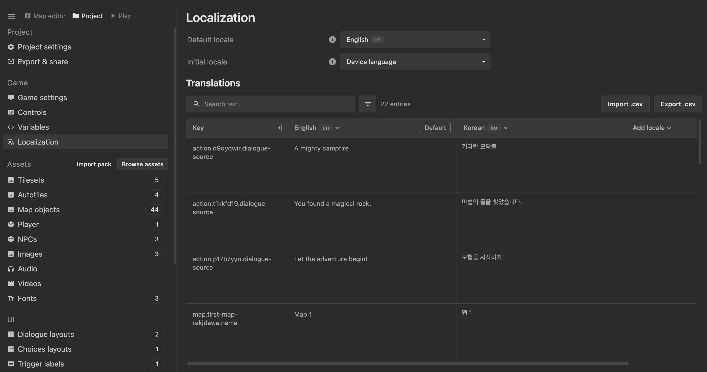

Localization lets you translate all text in your game, including dialogue, UI menus, NPC names, etc. Everything localization related exists in the localzation page under **Project > Localization**.

## Setting your game's locale

A locale represents a language, sometimes with a region. For example, `en` is English, `fr` is French, and `fr-CA` is French as used in Canada.

In the localization page, you can specify the default and initial locales of your game.

- **Default locale**: The language your game is written in. You can set this to be the language your game is created in.
- **Initial locale**: The language your player starts the game in. You can choose a specific locale or **Device language**, which falls back to the default locale if no matching language is available.

## Breaking down the localization table

The following are the columns in the localization table:

- **Key**: A special identifier the engine uses to know where the text belongs. You can click on the key to go to where the text exists in the editor.
- **Default text**: This is the game's default text, in the language it's created in.
- **Translation columns**: Each remaining column holds translations for the default game text.

Each row in the localization table represents some text in your game, identified by the key. The rows are automatically generated as you create your game. As more text is added to your game, they will surface in the table as "Missing translation" warnings.

### Adding a locale

Click **Add locale** in the top right of the table headings, then search for and select a language. A new column appears for you to fill in.

You can also add locale codes in the exported CSV file, which are added when importing the CSV.

## Translating with .csv

A `.csv` file stores a table as text, with values separated by commas.

Exporting the localization table as `.csv` is useful if you want to translate your game with a translation service or software. The translator can translate the `.csv` and you can import the completed translations once its done.

When translating the `.csv`, make sure to keep the key column and source text column unchanged. You can add new locale columns as needed by putting the locale code as the header. Dialogue can also contain commands and action IDs. Make sure any of those commands and IDs are preserved in the translation, otherwise the game will not work as expected.

Importing a `.csv` will never change your game's original text. It can only ever change or add to the translations.

## Translation warnings

When importing a `.csv` for translation, check for these warnings and notices:

- **Command / ID warning:** The translation's dialogue commands or action IDs don't match the default text. This means the game will not function as expected when the dialogue plays, and you must fix any commands/actions in the translated dialogue.
- **Source text changed:** The original game text has changed, so the translation needs review for whether to update it.
- **Source deleted:** The original game text no longer exists. Its translations remain stored but unused.
- **Missing translation:** No translation is provided. The game uses the default text instead. Empty CSV cells leave existing translations unchanged.
- **Stale translation skipped:** A translation based on older source text conflicts with an existing current translation. The current translation is preserved.
- **Unknown key:** A CSV row doesn't match any current game text and is skipped.

## Trying your translations

Use the locale selector in **Play test** to check each language. Any text in the game will change according to the locale. This is useful for testing your translations are working as expected.
